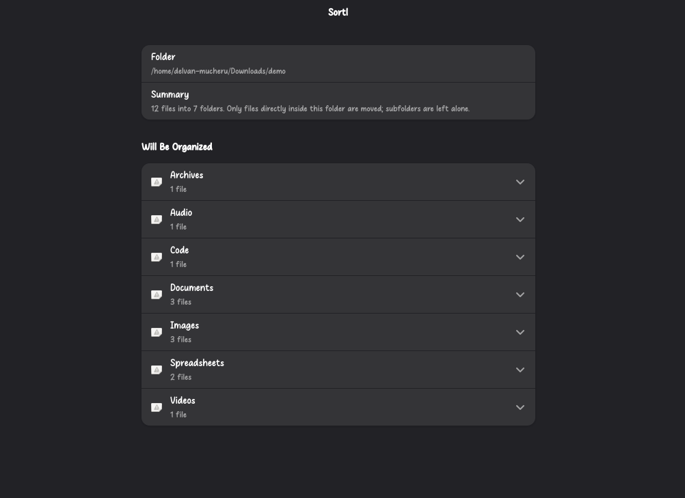
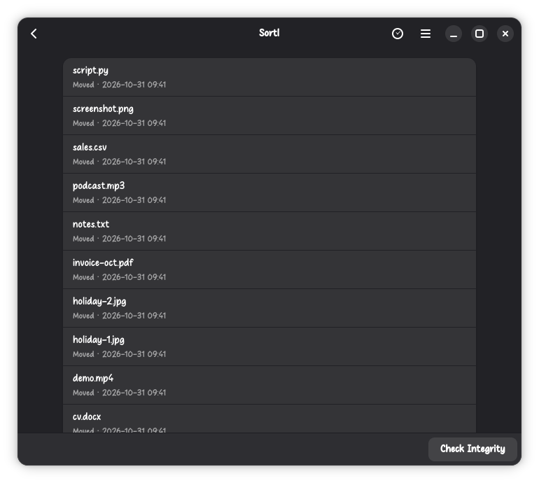

# Sortl

**Tidy a messy folder in one click, without ever losing a file.**

Sortl sorts the files in a folder (Downloads, say) into category folders such
as Images, Documents and Archives. It shows you exactly what will move before
anything changes, then moves each file, verifies it, and writes it to a history
you can inspect afterwards.

| Preview before anything moves | Review what was moved |
| --- | --- |
|  |  |

## Install

Sortl is distributed as a Debian package. It needs **Ubuntu 24.04 LTS or
newer**. The package depends on Python 3.12+, GTK 4.10+ and libadwaita 1.5+, so
other Debian-based systems with those versions (for example Debian 13) should
work too, but only Ubuntu has been tested.

1. Download the latest `sortl_<version>-1_all.deb` from the
   [Releases page](https://github.com/mucheru-delvan/Sortl/releases).
2. (Optional) Verify the download against the checksum in the release notes:

   ```sh
   sha256sum sortl_*_all.deb
   ```

3. Install it from the folder where you saved it:

   ```sh
   sudo apt install ./sortl_0.1.1-1_all.deb
   ```

apt installs the GTK and libadwaita dependencies for you. Then open **Sortl**
from your app grid. To remove it:

```sh
sudo apt remove sortl
```

Your move history stays in `~/.local/share/sortl/`. Delete that folder too if
you want it gone. Sortl does not update itself; to upgrade, install the newer
`.deb` the same way.

## How to use it

1. Click **Choose Folder…** and pick a folder.
2. Review the preview: every file and the folder it will go into. Files that
   would collide with an existing name are listed as skipped.
3. Click **Organize**. You can stop at any time; the current file finishes
   first.
4. Open **History** (the clock icon) to see every recorded move, and press
   **Check Integrity** to have Sortl re-verify them without changing any file.

## Categories

Extensions are matched case-insensitively. Anything not listed, including files
with no extension, goes to **Other**.

| Folder | Extensions |
| --- | --- |
| Images | `.jpg` `.jpeg` `.png` `.gif` `.webp` `.svg` |
| Documents | `.pdf` `.doc` `.docx` `.txt` `.odt` `.rtf` |
| Spreadsheets | `.csv` `.xls` `.xlsx` `.ods` |
| Archives | `.zip` `.tar` `.gz` `.7z` `.rar` |
| Audio | `.mp3` `.wav` `.flac` `.aac` `.ogg` |
| Videos | `.mp4` `.mkv` `.mov` `.avi` `.webm` |
| Code | `.py` `.js` `.ts` `.java` `.c` `.cpp` `.html` `.css` |
| Other | everything else |

## How it keeps your files safe

- **Preview first.** Nothing moves until you confirm the plan.
- **No overwrites.** If a file with the same name already exists in the
  destination, the file is skipped and left where it is.
- **Verified moves.** Each file is hashed when the plan is built. A move
  creates a hard link at the new location, checks that its content hash and
  file identity match, and only then removes the old name. A file is never
  copied and deleted.
- **Journaled.** Every move is recorded in a SQLite journal before it starts
  and again when it finishes.
- **Fails closed.** The first unexpected failure stops the whole run. Before
  starting, Sortl checks that the folder is writable and supports hard links
  (some USB drives and network shares don't) and refuses otherwise.
- **Recoverable.** The integrity check reads the journal and each file's
  current state, and reports what happened to every interrupted operation. It
  is read-only.

## Limitations

- Only files **directly inside** the chosen folder are moved. Subfolders and
  symbolic links are left alone.
- **Hidden files are not skipped.** Files whose names start with a dot are
  treated like any other file. Choose folders like Downloads rather than your
  home folder.
- The categories are fixed; they can't be configured yet.
- There is no undo button yet. The journal records every move, but you can't
  reverse a run from the interface.
- Sortl isn't sandboxed, so it can organize any folder you can write to.
  That's why the preview step matters.

## Layout

| Path | Purpose |
| --- | --- |
| `src/sortl/{planner,executor,journal,recovery,models}.py` | GTK-free core |
| `src/sortl/service.py` | Orchestration used by the UI (progress, cancel, hard-link check) |
| `src/sortl/ui/` | GTK4 + libadwaita front-end |
| `data/` | Desktop entry, AppStream metainfo, icons, screenshots |
| `packaging/deb/build-deb.sh` | Builds the `.deb` package |
| `tests/` | Core, service, packaging and GUI tests |

## Build the .deb

```sh
sudo apt install meson ninja-build dpkg-dev appstream desktop-file-utils
packaging/deb/build-deb.sh        # writes dist/sortl_<version>-1_all.deb
```

The build runs the desktop-file and AppStream validators first and fails if
either reports a problem.

## Run from source

Needs GTK 4, libadwaita 1.5+ and PyGObject from your distro
(`python3-gi gir1.2-gtk-4.0 gir1.2-adw-1` on Debian and Ubuntu).

```sh
PYTHONPATH=src python3 -c "from sortl import main; main()"
```

## Test

```sh
pip install pytest
pytest                      # core, service and packaging checks
# The GUI tests need a display; headless:
dbus-run-session -- xvfb-run -a env GSK_RENDERER=cairo pytest tests/test_ui_smoke.py
```

## License

MIT. See [LICENSE](LICENSE).
